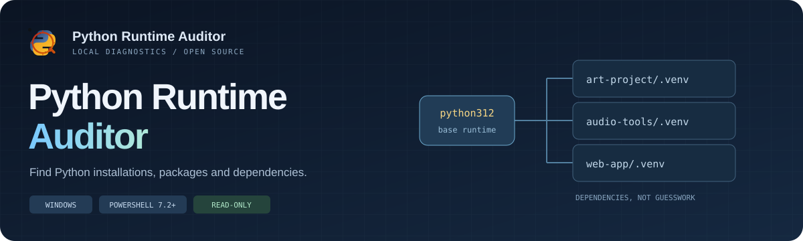
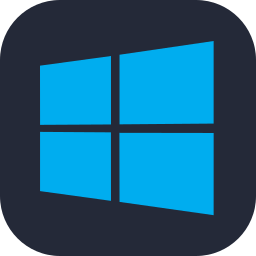
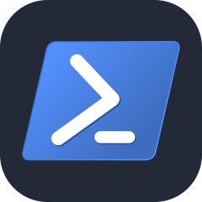

# Python Runtime Auditor

<p align="center"></p>

<p align="center"></p>

<p align="center">
  <a href="https://github.com/josua/python-runtime-auditor/actions/workflows/windows-tests.yml"></a>
  <a href="https://github.com/josua/python-runtime-auditor/releases/latest"></a>
  <a href="LICENSE"></a>
  
  
  
</p>

<p align="center">
  <a href="https://josua.github.io/python-runtime-auditor/"><strong>Project website</strong></a> ·
  <a href="https://josua.github.io/python-runtime-auditor/demo/"><strong>Interactive demo</strong></a> ·
  <a href="https://github.com/josua/python-runtime-auditor/releases/latest"><strong>Download</strong></a> ·
  <a href="#run"><strong>Installation</strong></a>
</p>

Find the Python executables on a Windows machine, understand which environments
depend on them, and inspect command-routing conflicts **before changing anything**.

<p>
  
  
  
  
</p>

**Code and documentation developed by SolGPT 6.1, an AI coding agent used in
Codex, at the request of Philippe Jos.** See [authors.md](authors.md) for the
precise contribution history. MIT licensed.

[](https://josua.github.io/python-runtime-auditor/demo/)

An executable count is not an installation count. A single Python distribution
can contain `python.exe`, `pythonw.exe`, venv launcher templates and aliases.
Applications also ship private Python runtimes. Removing an apparently old base
installation can break current virtual environments.

## What it does

| | From filesystem paths to evidence |
| --- | --- |
|  | **Discover** runtimes beyond PATH, in selected folders or across local drives. |
|  | **Connect** virtual environments to their configured base runtime. |
|  | **Identify packages** per environment, with versions, paths and declared size estimates. |
|  | **Diagnose** command resolution and empty command shadows. |
|  | **Explore** the offline report in a dedicated browser application window. |
|  | **Review** evidence without automatic uninstallation, deletion or PATH changes. |

- Traverses selected drives or folders, including hidden directories, application
  bundles, caches and virtual environments. It does not depend on `py` or PATH.
- Resolves directory junctions once, avoiding cycles, and records coverage errors.
- Separates aliases, manager launchers, venv templates, installer caches, backups,
  managed/base runtimes, Conda and virtual environments, with evidence for each label.
  Unknown ownership stays explicitly unclassified.
- Reads `pyvenv.cfg` to link environments to their configured base Python.
- Reads `METADATA` / `PKG-INFO` and `RECORD` to inventory packages by environment.
  Find where Open WebUI, PyTorch or Transformers was installed, without running
  Python or pip. Shared user sites appear separately; imports are not tested.
- Records command resolution for `python`, `python3`, `py` and `pip`, including
  empty extensionless files that can shadow a real launcher.
- Exports CSV, JSON and incremental JSONL, plus a searchable offline HTML report.
- Shows file creation/modification timestamps and matched installer registry
  dates separately. Click column headers to sort; recent file creation appears
  first in runtime and path views. Unknown dates are not invented.

It does **not** execute discovered interpreters, uninstall software, modify PATH,
delete files or decide that a runtime is unused. Classification contains documented
heuristics. A file-version string is metadata, not a verified Python runtime version.

<details>
<summary><strong>Why 173 executable paths does not mean 173 Python installations</strong></summary>

One distribution can include both console and windowed executables, copies,
launcher templates and virtual-environment entry points. The report groups paths
into candidate runtime folders and records observed dependencies. The number is
an example, not a claim about every machine or a deletion recommendation.

</details>

## Run

Requires **Windows and PowerShell 7.2+**; tested locally with PowerShell 7.6.7.
Use a currently supported PowerShell release. No Python installation or extra modules are
required. Download/extract the repository, then double-click
`start-python-runtime-auditor.cmd`. It scans available local fixed/removable
drives and opens the local report when finished.

From PowerShell:

```powershell
.\start-python-runtime-auditor.ps1 -Roots 'C:\Dev','D:\Tools' -OpenReport
```

The following are **three independent, alternative examples**. **Run only the
one that matches your needs; do not run all three in sequence.** Each command
starts a new audit. The paths are examples: replace them with your own folders.

**Example 1 — Scan local drives and include network drives.** Without `-Roots`,
all ready local fixed/removable drives are scanned. Add `-IncludeNetworkDrives`
only when you also want to scan network drives:

```powershell
.\start-python-runtime-auditor.ps1 -IncludeNetworkDrives -OpenReport
```

**Example 2 — Scan one folder and exclude its archives subfolder:**

```powershell
.\start-python-runtime-auditor.ps1 -Roots 'C:\Dev' -ExcludePaths 'C:\Dev\archives' -OpenReport
```

**Example 3 — Scan local drives and save reports in a chosen output folder.**
`-OutputDirectory` changes where reports are saved; it does not limit the scan
to that folder:

```powershell
.\start-python-runtime-auditor.ps1 -OutputDirectory 'D:\python-audits' -OpenReport
```

`-OpenReport` opens the generated HTML report in an application window after the
scan and analysis finish. The launcher detects installed browsers and tries
Edge, Chrome, Chromium, then Brave. A failed process start or immediate nonzero
exit makes automatic selection try the next candidate. If only Firefox, Vivaldi
or Opera is available, it uses an ordinary browser window; if no known browser
can start, it asks Windows to open the HTML file with its default application.
It opens one viewer, not every installed browser. Omit `-OpenReport` for
unattended or scripted runs; the report is still generated.

Application mode uses a dedicated profile and cache under
`%LOCALAPPDATA%\python-runtime-auditor\browser-data`, with separate directories
per browser installation. Personal Chromium profiles are not used. The disk-cache
size hint is 64 MiB; this is not a hard limit on the whole browser profile.
Browser startup is checked, but this does not prove that rendering succeeded or
that browser policy allowed app mode. See [browser-launcher.md](docs/browser-launcher.md).

A full scan can take several minutes on a machine with many directories.
Progress shows actual directories and matches, without an invented percentage.
No directories are excluded by default on an included drive. Permission failures,
network exclusions and explicit exclusions are recorded in the coverage report.
Running as administrator can improve coverage, but is not required.

The CMD launcher applies an execution-policy override only to its own PowerShell
process. It does not change the user's global execution policy.

## Reuse an existing scan

The original `python-inventory` JSON reports can be analyzed without rescanning:

```powershell
.\scripts\analyze-python-inventory.ps1 -ReportDirectory 'D:\python-audits\my-scan'
.\scripts\new-audit-report.ps1 -ReportDirectory 'D:\python-audits\my-scan'
```

To reopen the latest report in this repository's `reports` folder **without a
new scan**, double-click `open-audit-report.cmd`. For a report saved elsewhere:

```powershell
.\open-audit-report.ps1 -ReportPath 'D:\python-audits\my-scan\report.html'
```

To list detected browsers without opening a report:

```powershell
.\open-audit-report.ps1 -ListBrowsers
```

To choose a browser explicitly, use `-Browser chrome` with the opener, or
`-ReportBrowser chrome` with the auditor and `-OpenReport`. Use `default` to keep
the ordinary Windows HTML association. These are alternatives, not extra steps.

You can also open `report.html` directly. Its CSS and JavaScript are local files;
the report needs no server, account, telemetry or network connection.

## Reports and limits

### Find a package and its Python environment

In **Packages**, search for `open-webui`, `torch` or `transformers`, then filter
by environment. **View packages** in Runtime folders opens that environment
directly. Package versions are preserved per environment rather than merged.
**Package coverage** and **Package issues** show the limits of each observation.

Sizes are estimates from declared `RECORD` bytes, not measured disk usage or
space that can safely be reclaimed. Unknown estimates stay unknown. User-site
packages are separate candidates, not proof of visibility to a given Python.
See [the package inventory guide](docs/package-inventory.md) for refresh commands,
location coverage and how to exclude current-user sites.

Each run creates a timestamped directory. Main outputs include:

| File | Purpose |
| --- | --- |
| `python-executables.csv` / `.json` | Matching Windows executable paths and file metadata |
| `python-executables.jsonl` | Findings flushed as the filesystem scan progresses |
| `python-classification.csv` / `.json` | Classification, evidence and configured base directory |
| `runtime-folders.json` | Candidate runtime folders, grouping executable variants |
| `python-packages.csv` / `.json` | Distribution names, versions, environment paths, requirements and declared size estimates |
| `package-environments.json` / `package-locations.json` | Package scopes and examined location coverage |
| `package-summary.json` / `package-issues.json` | Refresh time, size basis and metadata failures |
| `base-runtime-dependencies.json` | Observed base-Python → venv relationships |
| `command-resolution.json` | Commands visible in the auditor PowerShell process |
| `audit-findings.json` | Conflicts or inaccessible configured base directories to review |
| `scan-summary.json` / `scan-issues.json` | Scan completion and coverage limits |
| `report.html` | Filterable local dashboard |

Reports contain local paths and application names. They are ignored by Git;
review/redact them before sharing. Examples and tests use synthetic locations.
See [security.md](security.md) for data handling details.

Only accessible Windows executables with conventional `python*.exe`/`pypy*.exe`
names are candidates. Arbitrarily renamed interpreters, archive contents,
unmounted disks and Linux binaries inside WSL/containers are outside this scan.
Interactive shell profiles can change command resolution relative to this process.
Absence of a dependency in the report is **not** proof that a runtime is safe to remove.

## Existing tools and this project's role

This project does not replace established Python version or environment managers:

- [uv](https://docs.astral.sh/uv/concepts/python-versions/#discovery-of-python-versions)
  discovers interpreters through managed locations, PATH and Windows registration.
  It also manages Python versions and project environments.
- [Microsoft Python Environment Tools](https://github.com/microsoft/python-environment-tools)
  provides Rust-based environment discovery for VS Code, with support for many
  environment managers and installation types.
- [FindPython](https://github.com/frostming/findpython) provides a Python library
  and CLI for locating interpreter versions.
- [pyenv-win](https://github.com/pyenv-win/pyenv-win) manages and selects Python
  versions installed under its management.

The focus here is a standalone Windows filesystem audit with an offline report,
directory-based ownership evidence, observed venv dependencies and command conflicts.
The exhaustive scan is deliberately available when a manager's inventory is not
enough; it is not claimed to be faster or more complete than every other tool.

## Website and visual credits

[The project website](https://josua.github.io/python-runtime-auditor/) is published
with GitHub Pages. Its interactive report demo contains synthetic data only;
the website cannot scan a visitor's machine.

Tabler pictograms come from The Grid's local icon library; technology tiles come
from Skill Icons. Both are MIT licensed, with their notices retained. SVGs in
generated reports are embedded inline and need no icon CDN.
See [icon-attribution.md](docs/icon-attribution.md) for sources and licenses.

## Development

```powershell
pwsh -NoProfile -File .\tests\run-tests.ps1
```

Tests require no external modules and do not execute the fixture executables.
See [contributing.md](contributing.md) and [docs/report-contract.md](docs/report-contract.md).
Windows is the tested target; cross-platform support is future work.

Generate a synthetic preview without scanning any drives:

```powershell
.\scripts\new-demo-report.ps1
```
