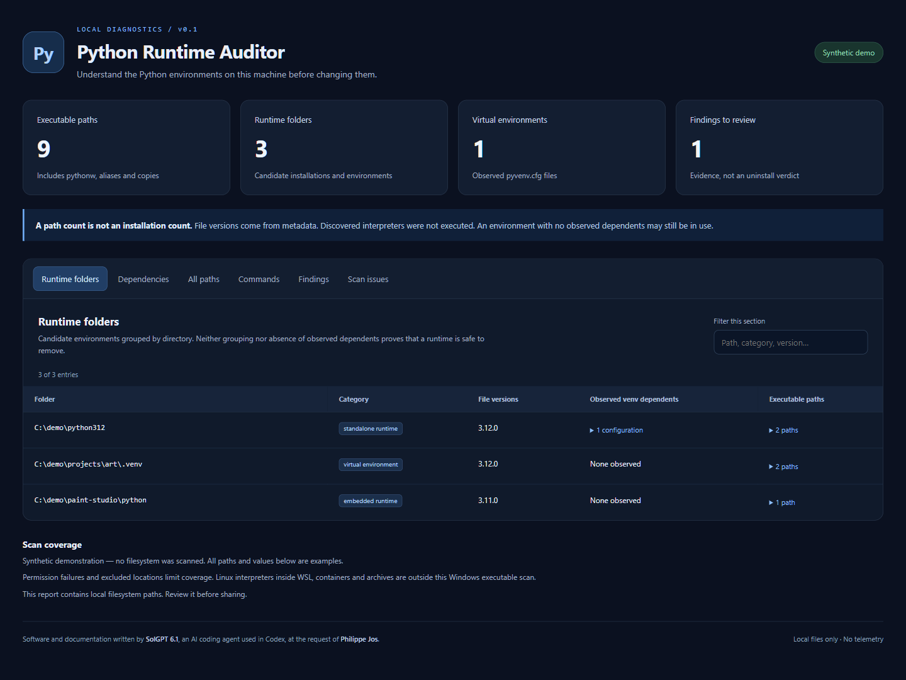

# Python Runtime Auditor

Find the Python executables on a Windows machine, understand which environments
depend on them, and inspect command-routing conflicts before changing anything.

**Code and documentation developed by SolGPT 6.1, an AI coding agent used in
Codex, at the request of Philippe Jos.** See [authors.md](authors.md) for the
precise contribution history. MIT licensed.



An executable count is not an installation count. A single Python distribution
can contain `python.exe`, `pythonw.exe`, venv launcher templates and aliases.
Applications also ship private Python runtimes. Removing an apparently old base
installation can break current virtual environments.

## What it does

- Traverses selected drives or folders, including hidden directories, application
  bundles, caches and virtual environments. It does not depend on `py` or PATH.
- Resolves directory junctions once, avoiding cycles, and records coverage errors.
- Separates aliases, manager launchers, venv templates, installer caches, backups,
  managed/base runtimes, Conda and virtual environments, with evidence for each label.
  Unknown ownership stays explicitly unclassified.
- Reads `pyvenv.cfg` to link environments to their configured base Python.
- Records command resolution for `python`, `python3`, `py` and `pip`, including
  empty extensionless files that can shadow a real launcher.
- Exports CSV, JSON and incremental JSONL, plus a searchable offline HTML report.

It does **not** execute discovered interpreters, uninstall software, modify PATH,
delete files or decide that a runtime is unused. Classification contains documented
heuristics. A file-version string is metadata, not a verified Python runtime version.

## Run

Requires **Windows and PowerShell 7.2+**; tested locally with PowerShell 7.6.7.
Use a currently supported PowerShell release. No Python installation or extra modules are
required. Download/extract the repository, then double-click
`start-python-runtime-auditor.cmd`. It scans available local fixed/removable
drives and opens the local report when finished.

From PowerShell:

```powershell
.\start-python-runtime-auditor.ps1 -Roots 'C:\Dev','D:\Tools' -OpenReport
```

Without `-Roots`, all ready local fixed/removable drives are scanned. Include
network drives only when explicitly requested:

```powershell
.\start-python-runtime-auditor.ps1 -IncludeNetworkDrives
.\start-python-runtime-auditor.ps1 -Roots 'C:\Dev' -ExcludePaths 'C:\Dev\archives'
.\start-python-runtime-auditor.ps1 -OutputDirectory 'D:\python-audits'
```

A full scan can take several minutes on a machine with many directories.
Progress shows actual directories and matches, without an invented percentage.
No directories are excluded by default on an included drive. Permission failures,
network exclusions and explicit exclusions are recorded in the coverage report.
Running as administrator can improve coverage, but is not required.

The CMD launcher applies an execution-policy override only to its own PowerShell
process. It does not change the user's global execution policy.

## Reuse an existing scan

The original `python-inventory` JSON reports can be analyzed without rescanning:

```powershell
.\scripts\analyze-python-inventory.ps1 -ReportDirectory 'D:\python-audits\my-scan'
.\scripts\new-audit-report.ps1 -ReportDirectory 'D:\python-audits\my-scan'
```

Open `report.html` in that directory. Its CSS and JavaScript are local files;
the report needs no server, account, telemetry or network connection.

## Reports and limits

Each run creates a timestamped directory. Main outputs include:

| File | Purpose |
| --- | --- |
| `python-executables.csv` / `.json` | Matching Windows executable paths and file metadata |
| `python-executables.jsonl` | Findings flushed as the filesystem scan progresses |
| `python-classification.csv` / `.json` | Classification, evidence and configured base directory |
| `runtime-folders.json` | Candidate runtime folders, grouping executable variants |
| `base-runtime-dependencies.json` | Observed base-Python → venv relationships |
| `command-resolution.json` | Commands visible in the auditor PowerShell process |
| `audit-findings.json` | Conflicts or inaccessible configured base directories to review |
| `scan-summary.json` / `scan-issues.json` | Scan completion and coverage limits |
| `report.html` | Filterable local dashboard |

Reports contain local paths and application names. They are ignored by Git;
review/redact them before sharing. Examples and tests use synthetic locations.
See [security.md](security.md) for data handling details.

Only accessible Windows executables with conventional `python*.exe`/`pypy*.exe`
names are candidates. Arbitrarily renamed interpreters, archive contents,
unmounted disks and Linux binaries inside WSL/containers are outside this scan.
Interactive shell profiles can change command resolution relative to this process.
Absence of a dependency in the report is **not** proof that a runtime is safe to remove.

## Existing tools and this project's role

This project does not replace established Python version or environment managers:

- [uv](https://docs.astral.sh/uv/concepts/python-versions/#discovery-of-python-versions)
  discovers interpreters through managed locations, PATH and Windows registration.
  It also manages Python versions and project environments.
- [Microsoft Python Environment Tools](https://github.com/microsoft/python-environment-tools)
  provides Rust-based environment discovery for VS Code, with support for many
  environment managers and installation types.
- [FindPython](https://github.com/frostming/findpython) provides a Python library
  and CLI for locating interpreter versions.
- [pyenv-win](https://github.com/pyenv-win/pyenv-win) manages and selects Python
  versions installed under its management.

The focus here is a standalone Windows filesystem audit with an offline report,
directory-based ownership evidence, observed venv dependencies and command conflicts.
The exhaustive scan is deliberately available when a manager's inventory is not
enough; it is not claimed to be faster or more complete than every other tool.

## Development

```powershell
pwsh -NoProfile -File .\tests\run-tests.ps1
```

Tests require no external modules and do not execute the fixture executables.
See [contributing.md](contributing.md) and [docs/report-contract.md](docs/report-contract.md).
Windows is the tested target for v0.1; cross-platform support is future work.

Generate a synthetic preview without scanning any drives:

```powershell
.\scripts\new-demo-report.ps1
```
